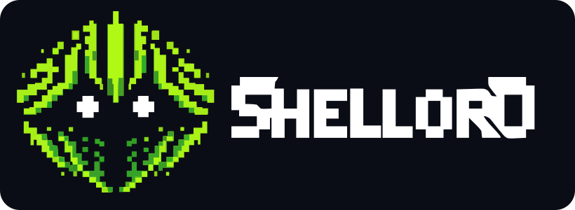

<p align="center">
  
</p>

<p align="center">
  <b>Un juego de rol multijugador masivo en línea (MMORPG) gratuito.</b><br>
  Explora el mundo, entra en portales y mazmorras, captura criaturas para invocarlas, forja tu equipo,
  bátete en duelos y comercia con otros jugadores.
</p>

<p align="center">
  <a href="https://get.microsoft.com/installer/download/9mwd6w1n8ltp?referrer=appbadge" target="_self">
    
  </a>
</p>

<p align="center">
  <a href="https://game.mibaltoalex.com"></a>
  <a href="https://t.me/shellord_bot"></a>
  <a href="https://t.me/shellord_channel"></a>
  <a href="https://editor.mibaltoalex.com"></a>
</p>

---

## Contenido

- [Dónde se juega](#dónde-se-juega)
- [Cómo entrar](#cómo-entrar)
- [Qué puedes hacer](#qué-puedes-hacer)
- [Herramientas para la comunidad](#herramientas-para-la-comunidad)
- [Contribuir con contenido](#contribuir-con-contenido)
- [Canales y comunidad](#canales-y-comunidad)
- [Licencia](#licencia)

---

## Dónde se juega

ShellOrd ya no se juega con comandos del bot: es un juego con su propio mapa, que se juega en:

| | Dónde | Cómo |
|---|---|---|
| 🪟 | **Windows** | Descárgalo de la [Microsoft Store](https://get.microsoft.com/installer/download/9mwd6w1n8ltp?referrer=appbadge). |
| 🌐 | **Navegador** | Entra en **[game.mibaltoalex.com](https://game.mibaltoalex.com)**, desde el ordenador o el móvil. |
| 🤖 | **Android** | Con la app de Android. |
| ✈️ | **Telegram** | Como mini app, desde **[@shellord_bot](https://t.me/shellord_bot)**. |

Tu partida es la misma en todos: puedes empezar en uno y seguir en otro.

> 🛠️ Cada día a las **04:00 (hora de Madrid)** el juego entra unos minutos en mantenimiento para guardar
> los datos. En cuanto termina, entras solo.

---

## Cómo entrar

Puedes jugar con una **cuenta del juego** (sin correo ni datos personales) o con tu **cuenta de Telegram**.

- **Cuenta del juego:** en la pantalla de acceso, toca «Crear una». Vincula una app de autenticación del
  móvil (Google Authenticator, Proton Authenticator, Aegis…) escaneando el código QR y guarda tu **ID**
  (empieza por «S») y tu **clave**. Para entrar: tu ID, tu clave y el código de 6 cifras de la app.
- **Con Telegram:** abre [@shellord_bot](https://t.me/shellord_bot) y escribe `/game`: te da tu clave de
  acceso. En el juego, pon tu ID de Telegram y esa clave, y el código de 6 cifras que te manda el bot.

Puedes recordar el dispositivo para no repetirlo durante 30 días. Al crear la cuenta y al entrar se
aceptan los [términos de uso](https://game.mibaltoalex.com/terminos/) y la
[política de privacidad](https://game.mibaltoalex.com/privacidad/).

---

## Qué puedes hacer

### 🗺️ El mundo, portales y mazmorras
Un mundo isométrico dividido en zonas por rango (E, D, C, B, A, S…): subiendo de nivel desbloqueas las
siguientes. En él están los **portales** a las mazmorras (cada uno con la insignia del elemento de sus
enemigos), cofres, vetas que minar, yunques de forja, estaciones de carga y NPCs. Las mazmorras tienen
muros, puertas con llave, pasajes, teletransportes, trampas ocultas, cofres y, a veces, varias salas y un
jefe final.

### ⚔️ Combate en tiempo real
- Tocas a un enemigo para atacarlo, defiendes y usas tus **habilidades** y **objetos** desde sus barras.
- **ATK**, **DEF** y la **energía** (tu vida) suben con el nivel, el equipo y el avatar.
- **Elementos** en todos los ataques: Tierra → Agua → Fuego → Aire → Tierra (quien gana pega un 20 % más),
  Oscuridad gana a los cuatro y solo pierde contra Luz, y Neutral ni gana ni pierde.
- **Estados** (veneno, quemadura, holoescudo, pesado…) que puedes tocar para ver qué hacen, y
  habilidades en área con forma (cono, cruz, muro, espiral…).
- Juega en **grupo** con otros jugadores dentro de la misma mazmorra.

### ✨ Habilidades, avatares e invocaciones
Más de 40 habilidades: curar, saltar, excavar, levantar y lanzar, atraer, invocar, rebobinar, pactos…
Se aprenden con el nivel, con **pergaminos** o con los **avatares**, que además cambian tu aspecto, tu
elemento y te dan bonificaciones. Algunos enemigos se pueden **capturar** para **invocarlos** después y
controlarlos tú.

### 🎒 Objetos, forja y oficios
Armas, escudos, orbes, pociones y materiales; equipas un arma, un escudo y un orbe a la vez. Con los
oficios de **minero**, **cazador** y **forjador** consigues materiales y fabricas armas, escudos y avatares.

### 🧑‍🤝‍🧑 NPCs, misiones y comercio
- **NPCs** que venden, que hablan contigo y que te dan **encargos** con recompensa (vuelve con ellos para cobrar).
- **Misiones** con recompensas de créditos, XP, objetos o habilidades.
- Se compra **a los vendedores del mundo**: no se puede comprar en medio de una mazmorra, así que hay que ir preparado.
- **Mercado** entre jugadores e **intercambio** directo de objetos.

### 🏆 Retos
**Duelos PvP**, **Atrapa la bandera** por equipos en el portal de evento, **gremios** y el **ranking**.

---

## Herramientas para la comunidad

Todas las herramientas están en **[editor.mibaltoalex.com](https://editor.mibaltoalex.com)**. Funcionan en el
navegador, sin instalar nada, y cargan los datos directamente de este repositorio (o de un JSON local).

| Herramienta | Edita | Enlace |
|---|---|---|
| 🗺️ Mazmorras | Mapas: muros, trampas, puertas, pasajes, cofres, NPCs y enemigos | [/mazmorras/](https://editor.mibaltoalex.com/mazmorras/) |
| 🎲 Tabla de spawn | Qué enemigos aparecen en cada mazmorra | [/spawn/](https://editor.mibaltoalex.com/spawn/) |
| 👾 Enemigos | Estadísticas, variantes, habilidades y marcas | [/enemigos/](https://editor.mibaltoalex.com/enemigos/) |
| ✨ Habilidades | Habilidades: qué hacen, a quién y con qué forma de área | [/habilidades/](https://editor.mibaltoalex.com/habilidades/) |
| 🧪 Efectos | Estados y efectos (veneno, holoescudo, pesado…) | [/efectos/](https://editor.mibaltoalex.com/efectos/) |
| 🤖 NPCs | Personajes, diálogos, encargos y comercio | [/npcs/](https://editor.mibaltoalex.com/npcs/) |
| ⚔️ Objetos | Armas, escudos, pociones, pergaminos y fórmulas de forja | [/objetos/](https://editor.mibaltoalex.com/objetos/) |
| 🛒 Tienda | Catálogo y precios de la tienda (la vende un NPC) | [/tienda/](https://editor.mibaltoalex.com/tienda/) |
| 🎁 Recompensas | Botín de cofres y misiones | [/recompensas/](https://editor.mibaltoalex.com/recompensas/) |
| 🗝️ Llaves | Llaves de acceso a mazmorras | [/llaves/](https://editor.mibaltoalex.com/llaves/) |
| 🧑‍🚀 Avatares | Avatares, sus habilidades y fórmulas | [/avatares/](https://editor.mibaltoalex.com/avatares/) |
| 🌐 Textos | Nombres y descripciones en cada idioma | [/locales/](https://editor.mibaltoalex.com/locales/) |

---

## Contribuir con contenido

Este repositorio contiene los **datos del juego**. El juego los descarga al arrancar y los vuelve a cargar
cada día en el mantenimiento, así que un cambio aceptado aquí llega al juego sin reiniciar nada.

```
├── mazmorras/          Mapas de cada mazmorra (un JSON por mapa)
├── locales/            Textos traducidos (es.json, …)
├── enemies.json        Enemigos y sus variantes
├── habilidades.json    Habilidades
├── efectos.json        Estados y efectos
├── spawn_table.json    Apariciones por mazmorra
├── objetos.json        Objetos, armas, escudos y fórmulas de forja
├── tienda.json         Catálogo de la tienda
├── recompensas.json    Recompensas de cofres y misiones
├── llaves.json         Llaves de mazmorras
├── misiones.json       Misiones y encargos
├── avatares.json       Avatares
└── npcs.json           NPCs
```

**Cómo proponer un cambio**

1. Abre la herramienta correspondiente y pulsa **🌐 Cargar del repo**.
2. Haz tus cambios y pulsa **Descargar** para obtener el JSON actualizado.
3. Haz un *fork* del repositorio, sustituye el fichero y abre un **Pull Request** explicando qué has cambiado.

¿Tienes una idea de mazmorra, enemigo u objeto pero no quieres editar datos? Compártela en el
[canal oficial](https://t.me/shellord_channel) o abre un *issue*.

---

## Canales y comunidad

| | Canal | Qué encontrarás |
|---|---|---|
| 🎮 | **[game.mibaltoalex.com](https://game.mibaltoalex.com)** | El juego en el navegador. |
| ✈️ | **[@shellord_bot](https://t.me/shellord_bot)** | El juego como mini app de Telegram y tu clave de acceso (`/game`). |
| 📢 | **[ShellOrd Oficial](https://t.me/shellord_channel)** | Noticias, salón de la fama, consejos, fan art y reporte de errores. |
| 🛠️ | **[editor.mibaltoalex.com](https://editor.mibaltoalex.com)** | Herramientas para crear contenido. |

---

## Licencia

Distribuido bajo la [Licencia Apache 2.0](LICENSE).
© Miguel J. Carmona (MIBALTOALEX).
